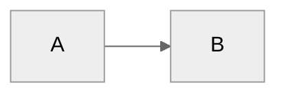
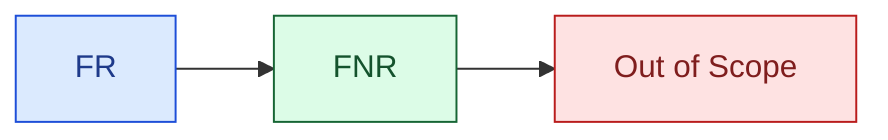
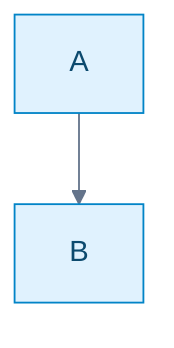

# Chart Command Guide

## Preferred diagram types

| Goal | Diagram type | Starter |
|------|--------------|---------|
| Requirement tree | mindmap | `mindmap` + `root((Feature))` |
| Process / SCADET | flowchart | `flowchart TD` |
| API / interaction | sequenceDiagram | `sequenceDiagram` |
| Trade-offs | quadrantChart | `quadrantChart` |
| UI states | stateDiagram-v2 | `stateDiagram-v2` |

## Styling

### Built-in theme

### Category colors with classDef

### Custom theme (base only)

Keep diagrams small and focused. One clear idea per chart.
